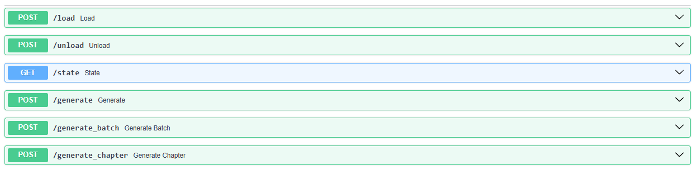

<div align="center">
  <h3 align="center">Qwen TTS API</h3>

  <p align="center">
    A small FastAPI service that wraps Qwen3-TTS (CustomVoice) behind a simple HTTP API for WAV generation.
    <br />
    Built as a companion module for <a href="https://github.com/KaMeLoTmArMoT/InfiniteBook">InfiniteBook</a>.
    <br /><br />
    <a href="../../issues">Report Bug</a>
    ·
    <a href="../../issues">Request Feature</a>
  </p>
</div>

<p align="center">
  
</p>

## About The Project
Qwen_TTS_Api is a lightweight HTTP service to synthesize narration/dialog audio as a single WAV file from a list of spans (narr/dialog/pause).  
It exists so InfiniteBook can use Qwen3-TTS like any other TTS provider without embedding heavy GPU model code into the web app process.

## Key Features
- Single request “chapter render”: send spans → receive one WAV (server handles batching + stitching).
- Model lifecycle endpoints: load/unload + state check.
- Docker-first deployment so the main app stays simple.

## Getting Started

### Prerequisites
- NVIDIA GPU + drivers (recommended).
- Docker (and NVIDIA Container Toolkit if you want `--gpus all`).

### Installation (clone)
```bash
git clone https://github.com/KaMeLoTmArMoT/Qwen_TTS_Api.git
cd Qwen_TTS_Api
```

## Docker

### Build
```bash
docker build -t qwen-tts-api .
```

### Run
Expose the API on port 8001 (pick any host port you want):
```bash
docker run --rm --gpus all -p 8001:8001 qwen-tts-api
```

Optional (if you want to preload a specific model at startup, depending on how you wired the container):
```bash
docker run --rm --gpus all -p 8001:8001 \
  -e QWEN_MODEL_ID="Qwen/Qwen3-TTS-12Hz-1.7B-CustomVoice" \
  qwen-tts-api
```

## InfiniteBook integration
In InfiniteBook, select the provider and point it at the container URL. [github](https://github.com/KaMeLoTmArMoT/InfiniteBook)

### Minimal `.env` (InfiniteBook)
```env
IB_TTS_PROVIDER=qwen
IB_QWEN_TTS_URL=http://127.0.0.1:8001
IB_QWEN_MODEL_ID=Qwen/Qwen3-TTS-12Hz-1.7B-CustomVoice
```

## License

This project is licensed under the MIT License — see [`LICENSE`](https://github.com/KaMeLoTmArMoT/InfiniteBook/blob/main/LICENSE).

## Acknowledgments

- README structure inspired by Best-README-Template.
- Built with assistance from generative AI tools for ideation and code suggestions; all changes were reviewed and tested by the author.
